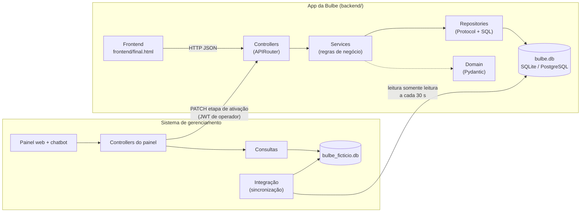

# Projeto Back-End — Bulbe Energia

API, frontend integrado e sistema de gerenciamento interno do app da **Bulbe Energia**, empresa de energia solar por assinatura de Minas Gerais. O cliente recebe créditos de energia de usinas remotas e paga menos na conta de luz, sem obra e sem fidelidade.

O projeto tem três partes que funcionam juntas:

| Parte | Pasta | O que é |
|---|---|---|
| **App (API)** | [`backend/`](backend/) | FastAPI em camadas (controllers, services, repositories, domain), SQLAlchemy 2 + Alembic, autenticação JWT de operadores |
| **App (frontend)** | [`frontend/`](frontend/) | Protótipo do Projeto Ciência de Dados I, ligado à API (`frontend/final.html`), com as telas novas de Entrar, Primeiro acesso, Abrir conta e Indicações (`telas.css` e `telas.js`) |
| **Sistema de gerenciamento** | [`sistema-de-gerenciamento/`](sistema-de-gerenciamento/) | Painel web para os funcionários da Bulbe, com chatbot (Claude Haiku 5.5). Lê os dados do app e altera a etapa de ativação pela API |

## Sobre o projeto

- **Empresa parceira:** Bulbe Energia ([bulbeenergia.com.br](https://bulbeenergia.com.br))
- **Problema que o projeto resolve:** quem conhece a Bulbe hoje precisa fazer login para entender o serviço, não consegue simular a economia antes de contratar e não acompanha o prazo de ativação (até 90 dias, dependente da CEMIG). O projeto cria a experiência aberta (modo visitante, simulador com bandeira tarifária, adesão pelo app), a jornada de ativação em 5 etapas, o Clube Bulbe (cartas semanais e cupons de parceiros) e um painel interno para a equipe acompanhar tudo isso.
- **Continuidade:** este repositório é o backend construído no Projeto Ciência de Dados II, consumido pelo frontend entregue no Projeto Ciência de Dados I. Repositório do frontend original: [gabrielmercedo/Bulbe-Squad-cleanergy](https://github.com/gabrielmercedo/Bulbe-Squad-cleanergy).

## Equipe (Cleanergy Squad)

| Nome | Matrícula |
|---|---|
| Samuel Gandra Paranhos (líder) | 2025 0713 9975 |
| Gabriel Mercedo Moreira Lins de Faria | 2025 0701 4226 |
| João Victor Silva Lenza | 2025 0701 4218 |
| Luiz Felipe Luppi Mendonça | 2025 0287 6254 |
| Rafael Alcântara Brescia | 2025 0100 7431 |
| Rodrigo Rennó Pimentel Bello Santos | (a informar) |

## Tecnologias utilizadas

- **Linguagem:** Python 3.10+ (desenvolvido e testado com 3.12–3.14); frontend em HTML, CSS e JavaScript puro
- **Framework:** FastAPI + Uvicorn; validação com Pydantic 2
- **Banco de dados:** SQLite em desenvolvimento (`backend/bulbe.db`); PostgreSQL via `BULBE_DATABASE_URL`
- **ORM:** SQLAlchemy 2, com migrations no Alembic
- **Autenticação:** JWT (PyJWT) e senhas com bcrypt
- **Testes:** Pytest (backend e sistema de gerenciamento), Playwright (navegador) e teste de ponta a ponta entre os sistemas
- **Outras ferramentas:** Swagger/OpenAPI (`/docs`), GitHub Actions, API da Anthropic (chatbot do painel)

## Arquitetura



- **Apresentação** (`app/controllers`): rotas FastAPI, validação de entrada e formato de erro `{"error": {code, message, status}}`.
- **Serviço** (`app/services`): regras de negócio (cálculo do simulador com bandeira, jornada de ativação, abertura de carta, validação de CPF).
- **Domínio** (`app/domain`): entidades e contratos em Pydantic.
- **Persistência** (`app/repositories`, `app/db`): um contrato `Protocol` por entidade, com implementação em memória (testes unitários) e SQL (API).

A integração entre os sistemas é descrita em [`sistema-de-gerenciamento/docs/integracao-com-o-app.md`](sistema-de-gerenciamento/docs/integracao-com-o-app.md). Diagramas de casos de uso, classes, atividade e sequência (PlantUML) estão em [`backend/docs/diagramas/`](backend/docs/diagramas/).

## Estrutura de pastas

```
backend/
├── app/
│   ├── controllers/    recebe requisições e formata respostas
│   ├── services/       regras de negócio e orquestração
│   ├── repositories/   acesso a dados (contrato + InMemory + SQL)
│   ├── domain/         entidades do domínio (Pydantic)
│   ├── core/           configuração, segurança (JWT/bcrypt) e dependências
│   └── db/             engine, modelos ORM e seed
├── migrations/         versões do Alembic
├── tests/              testes unitários e de integração (pytest)
├── docs/               requisitos, user stories, endpoints, OpenAPI, banco e diagramas
└── dev_frontend.py     serve API e frontend na mesma origem (desenvolvimento)
frontend/               app integrado (final.html, final.js, api.js, config.js)
sistema-de-gerenciamento/
├── app/                painel, chatbot, banco do painel e integração com o app
├── tests/              testes (pytest)
└── docs/               arquitetura, guia, LGPD, dicionário de dados e integração
integration-tests/      preservação do frontend, navegador (Playwright) e sistemas integrados
iniciar.py              sobe app e painel juntos
```

## Como executar o projeto

1. Clonar o repositório

   ```bash
   git clone https://github.com/luizfluppi/bulbe-cleanergy-backend.git
   cd bulbe-cleanergy-backend
   ```

2. Criar o ambiente e instalar as dependências das duas partes (Windows; no Linux/macOS use `.venv/bin/python`)

   ```bash
   python -m venv .venv
   .venv\Scripts\python.exe -m pip install -r requirements.txt
   ```

3. Configurar as variáveis de ambiente (opcional em desenvolvimento: sem `.env` os padrões funcionam)

   ```bash
   copy backend\.env.example backend\.env
   copy sistema-de-gerenciamento\.env.example sistema-de-gerenciamento\.env
   ```

   Para o chatbot do painel, preencha `ANTHROPIC_API_KEY` em `sistema-de-gerenciamento/.env`. O resto do painel funciona sem a chave.

4. Subir tudo (roda `alembic upgrade head` e o seed do app, depois os dois servidores)

   ```bash
   .venv\Scripts\python.exe iniciar.py
   ```

5. Abrir

   | O quê | Endereço |
   |---|---|
   | App (frontend) | <http://127.0.0.1:8000/frontend/final.html> |
   | API (Swagger) | <http://127.0.0.1:8000/docs> |
   | Sistema de gerenciamento | <http://127.0.0.1:8001/painel/> |

   Usuários de demonstração: operador da API `admin@bulbe.com.br` (senha no docstring de [`backend/app/db/seed.py`](backend/app/db/seed.py)) e funcionários do painel em [`sistema-de-gerenciamento/docs/guia-do-painel.md`](sistema-de-gerenciamento/docs/guia-do-painel.md).

   No app, **Entrar** pede o CPF de um cliente do seed (constantes `CPF_MARCOS` e `CPF_ANA` em `backend/app/db/seed.py`, dados fictícios). Fora de produção a tela mostra o código de 6 dígitos, porque não há envio real de SMS.

### Demonstração (entrega final)

- **Relógio de demonstração:** no topo do painel (admin) há "+1 dia", "+7 dias" e "Hoje". Ele adianta a data do app
  (cartas semanais do Clube, validade dos cupons) sem mexer no relógio do computador. Não existe com `BULBE_AMBIENTE=producao`.
- **Fale conosco:** no app, menu → Fale conosco. O assistente automático responde (prazo, fatura, Clube, indicação,
  endereço); "Falar com um atendente" coloca a conversa na fila do painel (Atendimentos), onde o funcionário responde.
- **Vitrine de dicas:** no painel (Dicas), arraste os cards para escolher as 5 que aparecem no app e clique em
  "Confirmar alterações".
- **Cupons:** no painel (Parceiros e cupons), cadastre cupons por parceiro. Cada cliente recebe por semana um cupom
  sorteado desse catálogo; a carta especial (5ª semana) é sempre R$ 50 de desconto na fatura.
- **Adesões:** no painel, aprove uma adesão feita no app para criar o cliente (ele faz o primeiro acesso pelo CPF).

O roteiro completo da apresentação está em [`ROTEIRO-APRESENTACAO.md`](ROTEIRO-APRESENTACAO.md).

Para rodar cada parte separadamente, veja [`QuickCommandIfError.txt`](QuickCommandIfError.txt), [`backend/docs/banco-de-dados.md`](backend/docs/banco-de-dados.md) e o [`README`](sistema-de-gerenciamento/README.md) do sistema de gerenciamento.

## Como rodar os testes

```bash
cd backend && ..\.venv\Scripts\python.exe -m pytest
cd sistema-de-gerenciamento && ..\.venv\Scripts\python.exe -m pytest
.venv\Scripts\python.exe integration-tests\check_preservation.py
.venv\Scripts\python.exe integration-tests\test_sistemas_integrados.py
```

Teste de navegador (opcional, exige Playwright):

```bash
.venv\Scripts\python.exe -m pip install playwright
.venv\Scripts\python.exe -m playwright install chromium
.venv\Scripts\python.exe integration-tests\test_browser.py
```

O GitHub Actions ([`.github/workflows/testes.yml`](.github/workflows/testes.yml)) roda as suítes, a verificação de preservação, o `alembic check` e o teste entre sistemas a cada push e pull request.

## Documentação da API

Contrato completo em [`backend/docs/api/openapi.json`](backend/docs/api/openapi.json) (gerado do código por `python gerar_openapi.py` na pasta `backend/`) e no Swagger em `/docs`. Design original, requisitos e user stories em [`backend/docs/`](backend/docs/). Inventário de rotas e quais exigem token em [`INTEGRATION.md`](INTEGRATION.md#inventário-da-api-implementada).

Principais endpoints:

| Método | Rota | Descrição |
|---|---|---|
| POST | `/v1/auth/login` | Login de operador (JWT) |
| POST | `/v1/adesoes` | Nova adesão pelo app |
| POST | `/v1/primeiro-acesso/verificacoes` | Verifica o CPF e envia o código de primeiro acesso |
| GET | `/v1/clientes/{id}/ativacao` | Etapa e progresso da ativação |
| PATCH | `/v1/clientes/{id}/ativacao` | Avança ou corrige a etapa (operador) |
| POST | `/v1/simulacoes` | Simula a economia com a bandeira tarifária do mês |
| GET | `/v1/bandeiras/atual` | Bandeira tarifária vigente |
| GET | `/v1/clientes/{id}/clube` | Sequência e próxima carta do Clube Bulbe |
| POST | `/v1/cartas/{id}/abertura` | Abre a carta da semana e gera o cupom |
| PATCH | `/v1/cupons/{id}` | Salva ou usa um cupom |
| POST | `/v1/indicacoes` | Registra uma indicação |
| GET | `/v1/parceiros` | Parceiros do Clube Bulbe |
| GET | `/v1/dicas` | Dicas de economia |

## Banco de dados

Tabelas, chaves estrangeiras, migrations, seed e testes com banco de teste: [`backend/docs/banco-de-dados.md`](backend/docs/banco-de-dados.md). Modelo do banco do painel: [`sistema-de-gerenciamento/docs/dicionario-de-dados.md`](sistema-de-gerenciamento/docs/dicionario-de-dados.md).

## Sprints e backlog

- Board do projeto: (link a informar pela equipe)
- Requisitos: [`backend/docs/Lista_de_requisitos.md`](backend/docs/Lista_de_requisitos.md) · User stories: [`backend/docs/user-stories.md`](backend/docs/user-stories.md)
- Apresentação da Sprint III: [`Slide Sprint III.pptx`](Slide%20Sprint%20III.pptx)

## Convenção de commits e branches

- Branches: `main` (estável) e `feat/`, `fix/`, `docs/`, `chore/` para o trabalho em andamento
- Commits no padrão Conventional Commits: `feat:`, `fix:`, `docs:`, `test:`, `refactor:`, `chore:`
- Pull requests revisados por pelo menos um integrante do grupo antes do merge

## Extensão universitária

> Texto proposto; a equipe deve revisar antes da entrega (Aula 32).

O projeto se conecta ao eixo de **sustentabilidade e educação ambiental**. A Bulbe leva energia solar a quem não pode ou não quer instalar placas: o cliente recebe créditos de usinas remotas, sem obra e sem investimento inicial, o que amplia o acesso à energia renovável para quem mora de aluguel ou em apartamento. O app reforça esse papel educativo: o simulador mostra quanto se economiza e como a bandeira tarifária encarece a energia nos meses de geração mais cara, as dicas de economia ensinam hábitos de consumo consciente com o ganho estimado de cada um, e o programa de indicação incentiva a adoção da energia limpa na comunidade do cliente.

## Contexto acadêmico

Projeto desenvolvido para a disciplina Projeto Ciência de Dados II, Ibmec, 2º semestre de 2026, sob orientação do professor Cristiano de Macedo Neto, M.Sc.

No desenvolvimento foi utilizado um agente de IA de programação (Claude Code) como ferramenta de apoio; os detalhes estão no [`README`](sistema-de-gerenciamento/README.md#uso-de-ia-no-desenvolvimento) do sistema de gerenciamento.
