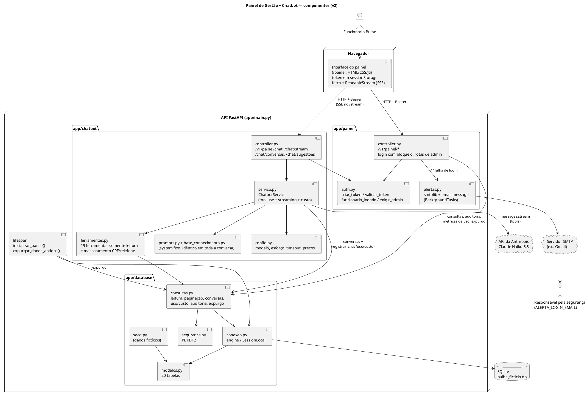
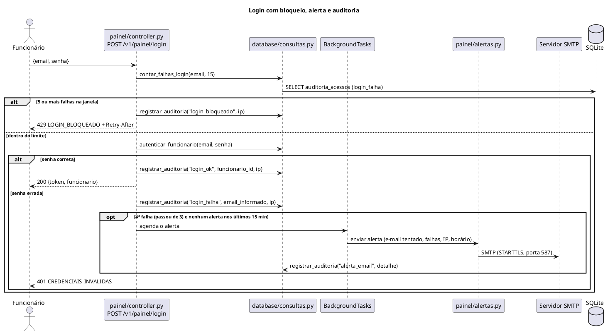
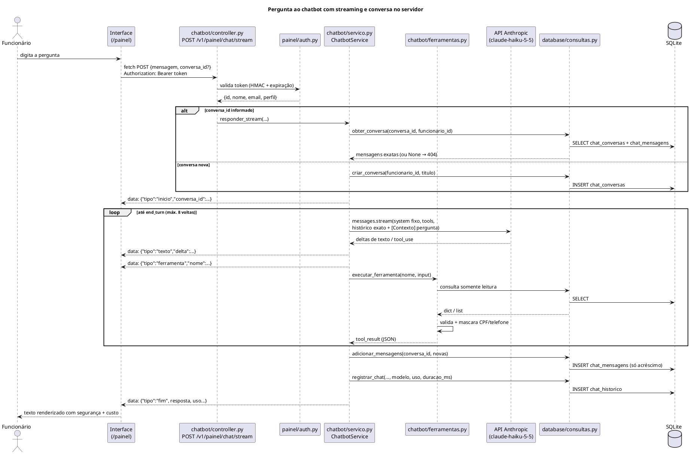

# Arquitetura — Painel de Gestão + Chatbot

> Stack: **FastAPI** + **SQLAlchemy 2 (SQLite)** + **SDK oficial `anthropic` 1.x (Claude Haiku 5.5, `claude-haiku-5-5`)** + HTML/CSS/JS puro.
> Branches: `feat/python-adiciona-chatbot` (v1) e `feat/python-melhorias-sistema` (v2).

## 0. O que mudou na v2

| Tema | v1 | v2 |
|---|---|---|
| Resposta do chat | Resposta inteira de uma vez (`POST /v1/painel/chat`) | Também em **streaming SSE** (`POST /v1/painel/chat/stream`): o texto aparece enquanto é gerado |
| Histórico do chat | Só na memória da página, reenviado como texto | **Conversas no servidor** (`chat_conversas` + `chat_mensagens`), histórico **só de acréscimo** com o conteúdo exato da API |
| Custo do chatbot | Não medido | Tokens e **custo estimado em US$** gravados por pergunta; tela **Uso do assistente** (admin) |
| Login | Sem limite de tentativas | **Bloqueio** (429) após 5 falhas em 15 min e **alerta por e-mail** na 4ª falha |
| Auditoria | `chat_historico` + log de abertura de ficha | Tabela **`auditoria_acessos`** (logins, bloqueios, alertas, fichas abertas, consultas à auditoria, expurgos); tela **Auditoria** (admin) |
| Retenção | Sem prazo | **Expurgo** de chat e auditoria antigos ao subir o servidor e por rota de admin |
| Listas | Limite fixo de linhas | **Paginação real** em clientes, adesões, atendimentos e auditoria |
| Operação | — | Tela **Ativações** (resumo e clientes parados), telas de **Dicas**, **Usinas** e **Parceiros**, bônus do Clube nas faturas |
| Qualidade | Sem testes | Suíte **pytest** (ver [testes.md](testes.md)) e casos de avaliação do chatbot |

## 1. Camadas

O sistema de gerenciamento fica na pasta `sistema-de-gerenciamento/`, **separado** do back-end do app
(pasta `backend/`). Ele é uma aplicação FastAPI própria, com três pacotes de código, a suíte de testes e esta
documentação (ver `CONTRATOS.md` e `CONTRATOS-MELHORIAS.md`). O back-end do app não é importado pelo sistema;
a futura integração entre os dois será pelo banco de dados.

| Camada / pacote | Responsabilidade | Arquivos |
|---|---|---|
| `app/database/` | Persistência em SQLite: modelos ORM (20 tabelas), conexão/sessão, seed fictício, consultas que devolvem JSON (leitura, paginação, gestão de ativações), conversas do chat, uso/custo, auditoria e retenção, hash de senha | `conexao.py`, `modelos.py`, `seed.py`, `consultas.py`, `seguranca.py` |
| `app/painel/` | Autenticação do funcionário (token HMAC), bloqueio de login e alerta por e-mail, auditoria de acesso, rotas `/v1/painel/*` (inclusive as de admin) e a interface web estática servida em `/painel` | `auth.py`, `alertas.py` (envio SMTP do alerta), `controller.py`, `static/index.html` + `login.js` (login), `static/painel.html` + `painel.css` + `painel.js` (app de uma página), `static/logo-bulbe.svg` |
| `app/chatbot/` | Integração com o Claude (loop de *tool use* com streaming), ferramentas, mascaramento, base de conhecimento, conversas no servidor, cálculo de custo e rotas `/v1/painel/chat` | `config.py` (variáveis, limites e preços), `base_conhecimento.py`, `prompts.py`, `ferramentas.py` (19 ferramentas, validação e mascaramento), `servico.py` (`ChatbotService`), `controller.py` (rotas), `avaliacoes/` (casos e script de avaliação) |
| `app/main.py` + `app/erros.py` | Carrega o `.env` antes dos demais imports; *lifespan* que chama `inicializar_banco()` e aplica a **retenção** (`expurgar_dados_antigos` com `CHAT_RETENCAO_DIAS` e `AUDITORIA_RETENCAO_DIAS`); *handlers* de `ErroDeNegocio` e de `StarletteHTTPException` no formato `{"error": {...}}`; routers do painel e do chatbot; estáticos em `/painel` | `main.py`, `erros.py` |
| `tests/` | Suíte `pytest` com banco SQLite temporário e cliente da Anthropic simulado | ver [testes.md](testes.md) |

Regras de dependência entre os pacotes:

- `painel` → `database` (consultas, autenticação, auditoria, métricas de uso).
- `chatbot` → `database` (consultas somente leitura, conversas e `registrar_chat`) e `chatbot` → `painel.auth` (dependência `funcionario_logado`).
- `database` não importa nada de `painel` nem de `chatbot`.
- A interface web só conversa com a API por HTTP (`fetch` em `/v1/painel/...`), com o token no cabeçalho `Authorization: Bearer <token>`.

## 2. Diagrama de componentes



## 3. Fluxo de uma pergunta ao chatbot (streaming, passo a passo)

Exemplo: o atendente digita **"Em que etapa da ativação está o Marcos Andrade?"** numa conversa nova.

1. **Interface** — o chat envia `POST /v1/painel/chat/stream` com `{"mensagem": "...", "conversa_id": null}`
   e o cabeçalho `Authorization: Bearer <token>`. Como o `EventSource` do navegador não aceita `POST` nem cabeçalho,
   a leitura do stream é feita com `fetch` + `ReadableStream`.
2. **Autenticação** — a dependência `funcionario_logado` (`app/painel/auth.py`) valida a assinatura
   HMAC-SHA256 e a expiração (8 h) do token. Token inválido → `401`.
3. **Disponibilidade** — sem `ANTHROPIC_API_KEY` (ou sem o pacote `anthropic`) o chatbot responde
   `503 CHATBOT_INDISPONIVEL` e o resto da API continua funcionando. Os problemas detectados **antes** de o stream
   começar (sem chave, conversa inexistente, conversa longa demais) saem como resposta HTTP comum com o status de
   erro, o que permite à interface cair para a rota sem streaming.
4. **Conversa** — sem `conversa_id`, o serviço cria uma conversa nova com `criar_conversa(funcionario_id, titulo)`
   (título = início da pergunta, até 60 caracteres) **antes** de chamar a API; se essa primeira pergunta falhar, a
   conversa fica vazia (`total_mensagens = 0`). Com `conversa_id`, carrega o histórico com
   `obter_conversa(conversa_id, funcionario_id)`, que devolve `None` se a conversa não existe **ou é de outro
   funcionário** (um funcionário nunca lê nem continua a conversa de outro) → `404 CONVERSA_NAO_ENCONTRADA`, sem chamar a API.
   O primeiro evento do stream é `{"tipo": "inicio", "conversa_id": "..."}`.
5. **Montagem da requisição** — o serviço reenvia **exatamente** as mensagens gravadas (inclusive blocos de
   `thinking`, `tool_use` e `tool_result`) e acrescenta a nova pergunta, prefixada com o contexto do momento,
   por exemplo `[Contexto: hoje é 18/10/2026; funcionário: Ana (atendimento)]`. Parâmetros:
   - `model` = `CHATBOT_MODELO` (padrão `claude-haiku-5-5`), `max_tokens` ≈ 8000;
   - `output_config={"effort": CHATBOT_ESFORCO}` (padrão `high`);
   - `system` = prompt fixo (`prompts.py` + base de conhecimento), **idêntico byte a byte** em toda a conversa,
     com `cache_control` para reaproveitar o cache de prompt. A data e o funcionário saíram do `system` na v2
     justamente para que ele nunca mude no meio de uma conversa. Além desse ponto de cache, a requisição usa
     `cache_control` automático para o histórico, que cresce a cada volta;
   - `tools` = as 19 ferramentas de `ferramentas.py`, com `eager_input_streaming: true` (iguais com e sem streaming);
   - *timeout* de `CHATBOT_TIMEOUT` segundos (padrão 60) e 2 novas tentativas automáticas do SDK.
   Não são enviados `budget_tokens`, `temperature`, `top_p`, *prefill* nem `tool_choice` forçado (o Haiku 5.5 usa
   pensamento adaptativo por padrão).
6. **Streaming** — a chamada usa `client.messages.stream(...)` e `get_final_message()` do SDK. Cada pedaço de texto
   vira um evento `{"tipo": "texto", "delta": "..."}`; assim que o modelo começa um bloco `tool_use`, sai
   `{"tipo": "ferramenta", "nome": "buscar_clientes"}`. Entre o texto de voltas diferentes chega um `delta` `"\n\n"`.
7. **Execução da ferramenta** — `executar_ferramenta(nome, entrada)` lê o `input` como **dict**, valida
   (tipos, enums, limites, textos de até 200 caracteres), chama a função **de mesmo nome** em
   `app.database.consultas`, **mascara CPF e telefone** e serializa em JSON (com limite de tamanho).
   Todos os `tool_result` de uma volta vão numa **única** mensagem `user`; erro → `is_error: true`.
8. **Novas voltas** — o loop repete os passos 6–7 até **8 voltas** no máximo. `stop_reason` tratado como na v1:
   `end_turn` (fim), `tool_use` (continua), `pause_turn` (continua), `max_tokens` (aviso de resposta truncada),
   `refusal` (mensagem amigável).
9. **Persistência** — quando a troca termina, as mensagens novas (pergunta, respostas do modelo e resultados de
   ferramentas) são acrescentadas de uma vez com `adicionar_mensagens(conversa_id, mensagens)`, sempre no fim (seção 4).
   Se o navegador fechar a conexão no meio do stream, a troca **não** é gravada nem registrada: um turno pela metade
   deixaria o histórico inválido.
10. **Uso e custo** — o serviço soma o `usage` de todas as voltas (entrada, saída, leitura e escrita de cache),
    estima o custo em US$ (seção 5) e grava a troca com
    `registrar_chat(funcionario_id, pergunta, resposta, ferramentas_usadas, conversa_id=..., modelo=..., uso=..., duracao_ms=...)`
    em `chat_historico`.
11. **Fim** — último evento: `{"tipo": "fim", "resposta": "<texto completo>", "ferramentas_usadas": [...], "modelo": "...", "conversa_id": "...", "uso": {...}}`.
    `resposta` junta o texto de todas as voltas (o mesmo que apareceu no stream) e é o texto definitivo: numa recusa,
    por exemplo, ele substitui o texto parcial já exibido. A interface escapa o HTML, converte só `**negrito**`,
    listas `- ` e quebras de linha, mostra as ferramentas consultadas e, discretamente, o custo da resposta. Se algo
    falhar no meio, sai `{"tipo": "erro", "error": {"code", "message", "status"}}` e o stream termina; a interface
    também desiste se o stream ficar 90 segundos sem enviar nada.

**Sem streaming:** `POST /v1/painel/chat` faz o mesmo fluxo e devolve, de uma vez,
`{resposta, ferramentas_usadas, modelo, conversa_id, uso}`. A interface usa essa rota como **reserva** quando o
stream falha antes de começar. Corpos antigos da v1 (com `historico` de texto e sem `conversa_id`) continuam aceitos.

### 3.1 Formato do stream (SSE)

A resposta tem `Content-Type: text/event-stream` (com `Cache-Control: no-cache` e `X-Accel-Buffering: no`, para
proxies não segurarem os pedaços). Cada evento é uma linha `data: <json>` seguida de uma linha em branco:

```text
data: {"tipo": "inicio", "conversa_id": "5f0c...e21"}

data: {"tipo": "ferramenta", "nome": "buscar_clientes"}

data: {"tipo": "ferramenta", "nome": "obter_ativacao"}

data: {"tipo": "texto", "delta": "O Marcos Andrade está na "}

data: {"tipo": "texto", "delta": "etapa 2 (Documentos)..."}

data: {"tipo": "fim", "resposta": "O Marcos Andrade está na etapa 2 (Documentos)...", "ferramentas_usadas": ["buscar_clientes", "obter_ativacao"], "modelo": "claude-haiku-5-5", "conversa_id": "5f0c...e21", "uso": {"input_tokens": 0, "output_tokens": 0, "cache_read_tokens": 0, "cache_creation_tokens": 0, "custo_estimado_usd": 0.0}}
```

| `tipo` | Campos | Quando |
|---|---|---|
| `inicio` | `conversa_id` | Primeiro evento, sempre |
| `texto` | `delta` | Pedaços da resposta, em ordem |
| `ferramenta` | `nome` | O modelo chamou uma ferramenta |
| `fim` | `resposta`, `ferramentas_usadas`, `modelo`, `conversa_id`, `uso` | Último evento de uma troca bem-sucedida |
| `erro` | `error: {code, message, status}` | Falha; encerra o stream |

### 3.2 Erros do SDK

Tratados em cadeia, do mais específico ao mais geral. Na rota sem streaming viram o status HTTP abaixo; no
stream (que já respondeu `200`) viram um evento `erro` com o mesmo `code` e `status`.

| Exceção do SDK | HTTP | `code` |
|---|---|---|
| `anthropic.RateLimitError` | 429 | `CHATBOT_LIMITE_REQUISICOES` |
| `anthropic.APIStatusError` 401/403 (chave recusada) | 503 | `CHATBOT_INDISPONIVEL` |
| `anthropic.APIStatusError` 500/503/529 (sobrecarga) | 503 | `CHATBOT_INDISPONIVEL` |
| `anthropic.APIStatusError` (demais) | 502 | `CHATBOT_ERRO_API` |
| `anthropic.APIConnectionError` | 503 | `CHATBOT_SEM_CONEXAO` |
| Erro inesperado no meio do stream | 500 (só no evento `erro`) | `CHATBOT_ERRO_INTERNO` |

## 4. Conversas no servidor (histórico só de acréscimo)

- Cada conversa é uma linha em `chat_conversas` (id UUID, dono, título, datas) e cada mensagem da API é uma
  linha em `chat_mensagens`, com `ordem` única por conversa, `papel` (`user`/`assistant`), `conteudo_json`
  (o conteúdo **exato** enviado ou recebido da API, serializado sem alterar nada) e `texto` (o que a interface mostra;
  vazio para mensagens só de ferramenta).
- **Só de acréscimo:** `adicionar_mensagens` grava sempre depois da última `ordem` e nunca edita, reordena ou remove
  mensagens antigas. Assim a próxima volta reenvia ao modelo exatamente o que ele produziu antes, inclusive os blocos
  de raciocínio (*preserved thinking*), e o cache de prompt continua válido.
- O prompt de sistema não muda dentro da conversa; o que muda a cada pergunta (data e funcionário) vai no
  início do texto da pergunta.
- A interface lista as conversas do funcionário (`GET /v1/painel/chat/conversas`, até 20 por padrão) e reabre uma
  delas (`GET /v1/painel/chat/conversas/{id}`), que devolve só as mensagens com texto visível, com papel
  `funcionario`/`assistente`. Conversa de outro funcionário → `404`. O `conversa_id` atual fica na memória da página e
  em `sessionStorage`.
- **Limite de tamanho:** uma conversa aceita até `CHATBOT_MAX_MENSAGENS_CONVERSA` mensagens da API (padrão 200).
  Acima disso a pergunta recebe `409 CONVERSA_MUITO_LONGA` e o caminho é abrir uma **Nova conversa**: cortar o início
  do histórico invalidaria o raciocínio preservado.
- **Corpo no formato da v1** (com `historico` de texto e sem `conversa_id`): o histórico de texto é convertido como
  antes e gravado numa conversa nova junto com a troca, e o `conversa_id` devolvido passa a valer daí em diante.
- **Resposta cortada no meio de uma ferramenta** (`max_tokens` ou recusa): a ferramenta não roda; na pergunta
  seguinte o `tool_result` de erro correspondente vai antes do texto, o que mantém o histórico válido sem editá-lo.
- **Assinatura de raciocínio recusada** (por exemplo, se o prompt mudou entre versões do sistema e a API responde
  400): a pergunta é reenviada uma vez sem os blocos `thinking`, sem alterar o que está gravado.
- As conversas seguem a mesma retenção do `chat_historico` (seção 7).

## 5. Uso e custo do chatbot

- O serviço soma o `usage` de todas as voltas de uma pergunta: `input_tokens`, `output_tokens`,
  `cache_read_input_tokens` e `cache_creation_input_tokens` (gravados como `cache_read_tokens` e `cache_creation_tokens`).
- O custo estimado usa preços configuráveis em `app/chatbot/config.py` (valores de referência para o Claude Haiku 5.5):

  | Item | Preço de referência |
  |---|---|
  | Entrada | US$ 0,10 por milhão de tokens |
  | Saída | US$ 0,50 por milhão de tokens |
  | Leitura de cache | 0,1 × o preço de entrada |
  | Escrita de cache | 1,25 × o preço de entrada |

  `custo = (entrada × p_in + saída × p_out + leitura_cache × 0,1 × p_in + escrita_cache × 1,25 × p_in) / 1.000.000`.
  Numa chamada com mais de 100 mil tokens de entrada vale a tabela de **prompt longo** (referência: US$ 0,50 entrada e
  US$ 2,50 saída por milhão). Todos esses valores podem ser trocados pelo `.env` (`CHATBOT_PRECO_ENTRADA_MTOK`,
  `CHATBOT_PRECO_SAIDA_MTOK`, `CHATBOT_FATOR_CACHE_LEITURA`, `CHATBOT_FATOR_CACHE_ESCRITA`, `CHATBOT_LIMITE_PROMPT_LONGO`,
  `CHATBOT_PRECO_ENTRADA_LONGO_MTOK`, `CHATBOT_PRECO_SAIDA_LONGO_MTOK`) se os preços mudarem ou se outro modelo for usado.
  É uma **estimativa** para acompanhamento; a cobrança oficial é a do console da Anthropic.
- Cada pergunta grava em `chat_historico`: `modelo`, os quatro contadores de tokens, `custo_estimado_usd` e `duracao_ms`.
- `metricas_uso_chatbot(dias)` agrega o período (perguntas, conversas, funcionários ativos, tokens, custo total e
  médio por pergunta, duração média, ranking por funcionário, ferramentas mais usadas e série por dia) e alimenta a
  tela **Uso do assistente** (`GET /v1/painel/uso-chatbot`, só admin).

## 6. Login, bloqueio, alerta por e-mail e auditoria



- **Bloqueio:** a partir de `LOGIN_BLOQUEIO_APOS_FALHAS` (5) falhas do mesmo e-mail em `LOGIN_JANELA_MINUTOS` (15),
  o login responde `429 LOGIN_BLOQUEADO` com o cabeçalho `Retry-After` (a janela inteira, em segundos: 900 com o
  padrão), **mesmo com a senha certa**. O bloqueio vale para qualquer e-mail digitado, exista ele ou não.
  A contagem (`contar_falhas_login`) ignora maiúsculas/minúsculas do e-mail.
- **Alerta:** quando o e-mail passa de `LOGIN_ALERTA_APOS_FALHAS` (3) falhas, ou seja, na 4ª, um único e-mail é enviado
  para `ALERTA_LOGIN_EMAIL`. O limite de um alerta por e-mail tentado a cada janela é controlado em memória
  (`alertas.reservar_alerta`, com trava para requisições simultâneas) e conferido na auditoria, o que cobre um
  reinício do servidor no meio da janela. O texto traz o e-mail tentado, o número de falhas, o IP e o horário de
  Brasília — **nunca** a senha digitada, que nem chega ao módulo `alertas.py`. O envio roda em segundo plano
  (`BackgroundTasks`), com STARTTLS quando `SMTP_TLS=true` e tempo limite de 15 s, sem atrasar a resposta. Sem SMTP
  configurado ou com erro de envio, o login segue normalmente, um aviso vai para o log e a ação `alerta_email` é
  registrada na auditoria com o motivo (o envio bem-sucedido também é registrado).
- As variáveis `LOGIN_*`, `SMTP_*` e `ALERTA_LOGIN_EMAIL` são lidas a cada uso; valores inválidos voltam ao padrão com
  aviso no log.
- **Auditoria de acesso** (`auditoria_acessos`), com o IP da requisição (`request.client.host`): `login_ok`,
  `login_falha` (com o `funcionario_id` quando o e-mail pertence a um funcionário), `login_bloqueado`, `alerta_email`,
  `ver_ficha` (cada abertura de ficha de cliente), `ver_auditoria` (cada consulta à própria auditoria, com os filtros
  usados) e `expurgo`. Uma falha ao gravar a auditoria vai para o log e não derruba a rota.

## 7. Retenção e expurgo

`expurgar_dados_antigos(dias_chat, dias_auditoria)` apaga:

- `chat_historico`, `chat_mensagens` e `chat_conversas` mais antigos que `CHAT_RETENCAO_DIAS` (padrão **180** dias;
  a idade da conversa é contada pela última atualização);
- `auditoria_acessos` mais antiga que `AUDITORIA_RETENCAO_DIAS` (padrão **730** dias).

Roda **automaticamente ao subir o servidor** (no *lifespan* de `app/main.py`; uma falha ali só gera log e não
impede a subida) e **sob demanda** em `POST /v1/painel/admin/expurgo` (só admin), que grava a ação `expurgo` na
auditoria e devolve quantos registros saíram de cada tabela e os prazos usados:
`{"chat_historico": 0, "chat_conversas": 0, "chat_mensagens": 0, "auditoria": 0, "dias_chat": 180, "dias_auditoria": 730}`.
As mensagens de uma conversa apagada saem junto com ela (`ON DELETE CASCADE`).

Ao subir, `inicializar_banco()` também acrescenta as colunas da v2 que faltarem num banco criado pela v1 (com aviso no
log), para a API não quebrar; mesmo assim o caminho recomendado depois da atualização é recriar o banco com
`python -m app.database.seed`.

## 8. Ferramentas do chatbot

Todas são **somente leitura** e mapeiam 1-para-1 nas funções de `app.database.consultas` (o nome da ferramenta é
o nome da função). `autenticar_funcionario`, `obter_funcionario`, `registrar_chat` e as funções de conversa,
auditoria, uso e expurgo **não** são expostas ao modelo.

| Ferramenta (função em `consultas.py`) | Para que o modelo usa |
|---|---|
| `buscar_clientes(termo, status, cidade, limite, etapa)` | Achar o cliente por nome, e-mail, CPF, nº de instalação ou código de indicação; **v2:** filtro por etapa da ativação |
| `obter_cliente(cliente_id)` | Dados cadastrais, endereço, usina, status, acesso ao app |
| `obter_ativacao(cliente_id)` | Etapa atual, percentual, previsão, eventos da jornada |
| `listar_clientes_parados(etapa, dias_minimos, limite)` | **v2:** clientes em ativação parados na mesma etapa há muito tempo, com indicação de atraso (mais de 90 dias do cadastro) |
| `resumo_ativacoes()` | **v2:** quantos em ativação, por etapa, dias médios na etapa, atrasados, ativados nos últimos 30 dias, tempo médio de ativação |
| `listar_faturas(cliente_id, situacao, limite)` | Faturas, vencimentos, valores em aberto; **v2:** inclui `bonus_clube` |
| `listar_faturas_vencidas(limite)` | Inadimplência geral, com `cliente_nome` e `dias_em_atraso` |
| `resumo_economia_cliente(cliente_id)` | Economia acumulada (desconto + indicações + **bônus do Clube**), faturas vencidas |
| `listar_indicacoes(cliente_id)` | Código, indicações e bônus acumulado |
| `obter_clube(cliente_id)` | Sequência do Clube Bulbe, próxima carta, bônus pendente |
| `listar_cupons(cliente_id, situacao)` | Cupons e parceiros |
| `listar_notificacoes(cliente_id, limite)` | O que foi enviado ao cliente |
| `listar_atendimentos(cliente_id, status, limite)` | Chamados abertos e resolvidos |
| `listar_adesoes(situacao, limite)` | Funil de adesões |
| `metricas_gerais()` | Números da operação; **v2:** a etapa 5 conta os ativados nos últimos 30 dias e o Clube mostra os bônus pagos |
| `listar_usinas()` | Usinas e status |
| `listar_parceiros(apenas_ativos)` | Parceiros do Clube |
| `listar_dicas()` | Dicas de economia |
| `simular_economia(valor_conta, meses, amigos_indicados)` | Simulação igual à do app |

## 9. Diagrama de sequência do chat com streaming



## 10. Rotas

| Método | Rota | Pacote | Acesso |
|---|---|---|---|
| POST | `/v1/painel/login` | painel | pública (e-mail + senha), com bloqueio e auditoria |
| GET | `/v1/painel/me` | painel | Bearer |
| GET | `/v1/painel/metricas` | painel | Bearer |
| GET | `/v1/painel/clientes?termo&status&cidade&etapa&pagina&por_pagina` | painel | Bearer — **paginada** (`limite` da v1 aceito como sinônimo de `por_pagina`) |
| GET | `/v1/painel/clientes/parados?etapa&dias_minimos&limite` | painel | Bearer |
| GET | `/v1/painel/clientes/{id}` | painel | Bearer — grava `ver_ficha` |
| GET | `/v1/painel/ativacoes/resumo` | painel | Bearer |
| GET | `/v1/painel/adesoes?situacao&pagina&por_pagina` | painel | Bearer — **paginada** |
| GET | `/v1/painel/atendimentos?status&cliente_id&pagina&por_pagina` | painel | Bearer — **paginada** |
| GET | `/v1/painel/usinas`, `/v1/painel/parceiros`, `/v1/painel/dicas` | painel | Bearer |
| GET | `/v1/painel/auditoria?funcionario_id&acao&pagina&por_pagina` | painel | **admin** — grava `ver_auditoria` (`por_pagina` padrão 50) |
| GET | `/v1/painel/uso-chatbot?dias` | painel | **admin** (`dias` de 1 a 365, padrão 30) |
| POST | `/v1/painel/admin/expurgo` | painel | **admin** — grava `expurgo` |
| POST | `/v1/painel/chat` | chatbot | Bearer |
| POST | `/v1/painel/chat/stream` | chatbot | Bearer — `text/event-stream` |
| GET | `/v1/painel/chat/conversas?limite` | chatbot | Bearer (só as do funcionário; `limite` de 1 a 100, padrão 20) |
| GET | `/v1/painel/chat/conversas/{id}` | chatbot | Bearer (404 se for de outro funcionário) |
| GET | `/v1/painel/chat/sugestoes` | chatbot | Bearer |
| GET | `/painel/` | estático | — (a tela de login é o `index.html`) |

**Formato paginado** (clientes, adesões, atendimentos, auditoria):
`{"data": [...], "pagina": 1, "por_pagina": 20, "total": 64, "total_paginas": 4}` — `por_pagina` de 1 a 100.

Erros seguem o formato do projeto: `{"error": {"code": "...", "message": "...", "status": 0}}`.
`ErroDeNegocio` (chatbot) e `HTTPException(detail={"error": {...}})` (painel e autenticação) chegam nesse formato
pelos *handlers* de `app/main.py`, que mantêm os cabeçalhos (ex.: `WWW-Authenticate` no 401, `Retry-After` no 429).

| Código | HTTP | Onde |
|---|---|---|
| `CREDENCIAIS_INVALIDAS` | 401 | Login com e-mail ou senha incorretos (mensagem genérica, não revela se o e-mail existe) |
| `LOGIN_BLOQUEADO` | 429 | **v2:** muitas falhas do mesmo e-mail na janela; vem com `Retry-After` |
| `NAO_AUTENTICADO` / `TOKEN_INVALIDO` | 401 | Sem cabeçalho `Authorization` / token adulterado ou expirado |
| `ACESSO_NEGADO` | 403 | Rota exclusiva de `admin` (auditoria, uso do assistente, expurgo) |
| `CLIENTE_NAO_ENCONTRADO` | 404 | Ficha de cliente inexistente |
| `CONVERSA_NAO_ENCONTRADA` | 404 | **v2:** conversa inexistente ou de outro funcionário |
| `CONVERSA_MUITO_LONGA` | 409 | **v2:** a conversa passou de `CHATBOT_MAX_MENSAGENS_CONVERSA` mensagens; abrir uma nova |
| `CHATBOT_HISTORICO_INDISPONIVEL` | 503 | **v2:** não foi possível ler ou criar a conversa no banco |
| `CHATBOT_ERRO_INTERNO` | 500 | **v2:** erro inesperado durante o stream (só como evento `erro`) |
| `CHATBOT_INDISPONIVEL` | 503 | Sem chave, chave recusada ou API sobrecarregada |
| `CHATBOT_LIMITE_REQUISICOES` | 429 | Limite de taxa da API da Anthropic |
| `CHATBOT_ERRO_API` | 502 | Outro erro da API da Anthropic |
| `CHATBOT_SEM_CONEXAO` | 503 | Falha de rede até a API |
