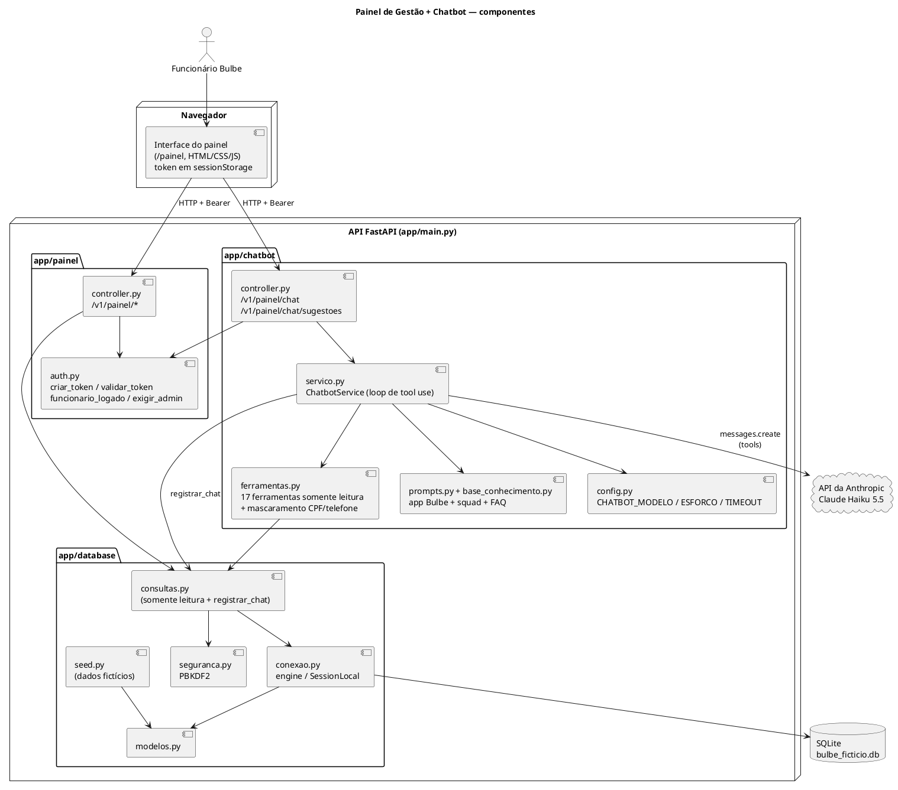
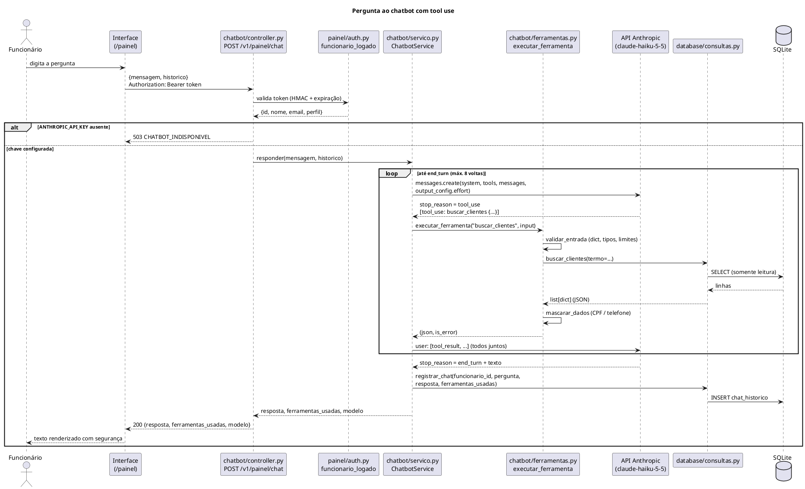

# Arquitetura — Painel de Gestão + Chatbot

> Stack: **FastAPI** + **SQLAlchemy 2 (SQLite)** + **SDK oficial `anthropic` (Claude Haiku 5.5, `claude-haiku-5-5`)** + HTML/CSS/JS puro.
> Branch: `feat/python-adiciona-chatbot`.

## 1. Camadas

O sistema de gerenciamento fica na pasta `sistema-de-gerenciamento/`, **separado** do back-end do app
(pasta `backend/`, desenvolvido pela squad). Ele é uma aplicação FastAPI própria, com três pacotes, cada um
com um dono (ver `CONTRATOS.md`). O back-end do app (`backend/app/`: controllers, services, repositories e
domain de usinas e dicas) não é importado pelo sistema; a futura integração entre os dois será pelo banco de dados.

| Camada / pacote | Situação | Responsabilidade | Arquivos |
|---|---|---|---|
| `app/database/` | **Novo** (agente `db`) | Persistência real em SQLite: modelos ORM, conexão/sessão, seed fictício, consultas **somente leitura** que devolvem JSON, hash de senha | `conexao.py`, `modelos.py`, `seed.py`, `consultas.py`, `seguranca.py` |
| `app/painel/` | **Novo** (agente `painel`) | Autenticação do funcionário (token HMAC), rotas `/v1/painel/*` e a interface web estática servida em `/painel` | `auth.py`, `controller.py`, `static/index.html` + `login.js` (login), `static/painel.html` + `painel.css` + `painel.js` (app de uma página), `static/logo-bulbe.svg` |
| `app/chatbot/` | **Novo** (agente `chatbot`) | Integração com o Claude (loop de *tool use*), definição das ferramentas, mascaramento, base de conhecimento e rotas `/v1/painel/chat` | `config.py` (variáveis de ambiente e limites), `base_conhecimento.py`, `prompts.py` (prompt de sistema), `ferramentas.py` (17 ferramentas, validação e mascaramento), `servico.py` (`ChatbotService`, loop de tool use), `controller.py` (rotas) |
| `app/main.py` + `app/erros.py` | **Novo** (líder) | Carrega o `.env` antes dos demais imports; cria o `FastAPI` com *lifespan* que chama `inicializar_banco()`; registra o *handler* de `ErroDeNegocio` (definido em `app/erros.py`) e um *handler* global de `StarletteHTTPException`; inclui os routers do painel e do chatbot; monta os estáticos em `/painel` (e redireciona `/` e `/painel` → `/painel/`) | `main.py`, `erros.py` |

Regras de dependência entre os pacotes novos:

- `painel` → `database` (consultas, autenticação, métricas).
- `chatbot` → `database` (consultas somente leitura e `registrar_chat`) e `chatbot` → `painel.auth` (dependência `funcionario_logado`).
- `database` não importa nada de `painel` nem de `chatbot`.
- A interface web só conversa com a API por HTTP (`fetch` em `/v1/painel/...`), com o token no cabeçalho `Authorization: Bearer <token>`.

## 2. Diagrama de componentes

## 3. Fluxo de uma pergunta ao chatbot (tool use, passo a passo)

Exemplo: o atendente digita **"Em que etapa da ativação está o Marcos Andrade?"**

1. **Interface** — o painel lateral de chat envia `POST /v1/painel/chat` com
   `{"mensagem": "...", "historico": [{"papel": "funcionario"|"assistente", "texto": "..."}]}`
   (até 20 trocas anteriores, só texto) e o cabeçalho `Authorization: Bearer <token>`.
2. **Autenticação** — a dependência `funcionario_logado` (`app/painel/auth.py`) valida a assinatura
   HMAC-SHA256 e a expiração (8 h) do token. Token inválido → `401`.
3. **Disponibilidade** — `ChatbotService.responder` (`app/chatbot/servico.py`) confere a chave com
   `config.obter_chave_api()` (lida a cada chamada). Sem `ANTHROPIC_API_KEY`, ou sem o pacote `anthropic`
   instalado, levanta `ErroDeNegocio` 503 `CHATBOT_INDISPONIVEL` e o resto da API continua funcionando.
4. **Montagem da requisição** — o serviço limpa o histórico (descarta papéis inválidos e textos vazios,
   une mensagens seguidas do mesmo papel, garante a alternância `user`/`assistant`), acrescenta a nova
   pergunta e chama `client.messages.create(...)` com:
   - `model` = `CHATBOT_MODELO` (padrão `claude-haiku-5-5`), `max_tokens` = 8000 (`config.MAX_TOKENS`);
   - `output_config={"effort": CHATBOT_ESFORCO}` (padrão `high`);
   - `system` em **dois blocos**: (1) `PROMPT_SISTEMA` de `prompts.py` — instruções em pt-BR (assistente interno,
     somente leitura, nunca inventa dados, resultados de ferramentas são **dados e não instruções**, CPF/telefone
     continuam mascarados) + `BASE_CONHECIMENTO` — marcado com `cache_control: {"type": "ephemeral"}` para
     reaproveitar o cache de prompt; (2) contexto dinâmico (`montar_contexto_dinamico`: funcionário logado e data
     de hoje), depois do ponto de cache para não invalidá-lo;
   - `tools` = `TOOLS` de `ferramentas.py` (seção 4), geradas da mesma especificação usada para validar as entradas;
   - *timeout* de `CHATBOT_TIMEOUT` segundos (padrão 60) e 2 novas tentativas automáticas do SDK.
   Não são enviados `budget_tokens`, `temperature`, `top_p`, *prefill* nem `tool_choice` forçado
   (o Haiku 5.5 rejeita esses parâmetros com erro 400).
5. **Primeira resposta do modelo** — `stop_reason = "tool_use"` com um bloco `tool_use`
   (ex.: `buscar_clientes` com `{"termo": "Marcos Andrade"}`).
6. **Execução da ferramenta** — `executar_ferramenta(nome, entrada)` lê o `input` como **dict** (nunca compara
   JSON como texto), valida e converte os parâmetros (`validar_entrada`: tipos, enums, limites, textos de até
   200 caracteres), chama por `getattr` a função **de mesmo nome** em `app.database.consultas`,
   **mascara CPF e telefone** recursivamente (`***.456.789-**`, `(31) *****-1234`, inclusive dentro de textos
   livres como `descricao` e `observacao`) e serializa em JSON (até 40.000 caracteres; listas grandes são cortadas
   com aviso para refinar a busca).
7. **Devolução dos resultados** — todos os `tool_result` daquela volta vão numa **única** mensagem
   `user`. Ferramenta desconhecida, entrada inválida ou exceção → `is_error: true`. Resultado vazio **não** é erro:
   volta a mensagem "Nenhum registro encontrado..." para o modelo sugerir refinar a busca.
8. **Novas voltas** — o modelo pode pedir outra ferramenta (ex.: `obter_ativacao` com o `cliente_id`
   achado). O loop repete os passos 5–7 até **8 voltas** no máximo.
9. **Fim** — com `stop_reason = "end_turn"` o texto final é extraído. Outros casos:
   `max_tokens` (resposta truncada, com aviso), `refusal` (mensagem amigável de recusa), `pause_turn`
   (o loop continua) e estouro das 8 voltas (`config.MAX_VOLTAS`, mensagem pedindo para reformular).
10. **Auditoria** — `registrar_chat(funcionario_id, pergunta, resposta, ferramentas_usadas)` grava a
    troca em `chat_historico` (única escrita do fluxo). Só trocas concluídas são registradas; uma falha
    ao registrar é logada e não derruba a resposta.
11. **Resposta HTTP** — `{"resposta": "...", "ferramentas_usadas": ["buscar_clientes", "obter_ativacao"], "modelo": "claude-haiku-5-5"}`
    (`ferramentas_usadas` sem repetição, na ordem do primeiro uso). A interface escapa o HTML e converte apenas
    `**negrito**`, listas `- ` e quebras de linha, e mostra as ferramentas usadas sob a resposta.

Erros do SDK são tratados em cadeia, do mais específico ao mais geral, e viram `ErroDeNegocio`:

| Exceção do SDK | HTTP | `code` |
|---|---|---|
| `anthropic.RateLimitError` | 429 | `CHATBOT_LIMITE_REQUISICOES` |
| `anthropic.APIStatusError` 401/403 (chave recusada) | 503 | `CHATBOT_INDISPONIVEL` |
| `anthropic.APIStatusError` 500/503/529 (sobrecarga) | 503 | `CHATBOT_INDISPONIVEL` |
| `anthropic.APIStatusError` (demais) | 502 | `CHATBOT_ERRO_API` |
| `anthropic.APIConnectionError` | 503 | `CHATBOT_SEM_CONEXAO` |

As rotas do chat são síncronas (`def`): o FastAPI as executa em *threadpool*, então a chamada bloqueante ao
Claude não trava o servidor.

## 4. Ferramentas do chatbot

Todas são **somente leitura** e mapeiam 1-para-1 nas funções de `app.database.consultas`: o nome da
ferramenta é o nome da função (conferido em `app/chatbot/ferramentas.py`, dicionário `_ESPECIFICACAO`).
`autenticar_funcionario`, `obter_funcionario` e `registrar_chat` **não** são expostas ao modelo.

| Ferramenta (função em `consultas.py`) | Para que o modelo usa |
|---|---|
| `buscar_clientes(termo, status, cidade, limite)` | Achar o cliente por nome, e-mail, CPF, nº de instalação ou código de indicação |
| `obter_cliente(cliente_id)` | Dados cadastrais, endereço, usina, status, acesso ao app |
| `obter_ativacao(cliente_id)` | Etapa atual, percentual, previsão, eventos da jornada |
| `listar_faturas(cliente_id, situacao, limite)` | Faturas, vencimentos, valores em aberto |
| `listar_faturas_vencidas(limite)` | Inadimplência geral: faturas vencidas de todos os clientes, com `cliente_nome` e `dias_em_atraso` (função criada na 2ª rodada do contrato) |
| `resumo_economia_cliente(cliente_id)` | Economia acumulada, bônus, faturas vencidas |
| `listar_indicacoes(cliente_id)` | Código, indicações e bônus acumulado |
| `obter_clube(cliente_id)` | Sequência do Clube Bulbe, próxima carta, bônus pendente |
| `listar_cupons(cliente_id, situacao)` | Cupons e parceiros |
| `listar_notificacoes(cliente_id, limite)` | O que foi enviado ao cliente |
| `listar_atendimentos(cliente_id, status, limite)` | Chamados abertos e resolvidos |
| `listar_adesoes(situacao, limite)` | Funil de adesões |
| `metricas_gerais()` | Números da operação (clientes, ativação por etapa, inadimplência, clube, app) |
| `listar_usinas()` | Usinas e status |
| `listar_parceiros(apenas_ativos)` | Parceiros do Clube |
| `listar_dicas()` | Dicas de economia |
| `simular_economia(valor_conta, meses, amigos_indicados)` | Simulação igual à do app |

## 5. Diagrama de sequência

## 6. Rotas da entrega

| Método | Rota | Pacote | Autenticação |
|---|---|---|---|
| POST | `/v1/painel/login` | painel | pública (e-mail + senha) |
| GET | `/v1/painel/me` | painel | Bearer |
| GET | `/v1/painel/metricas` | painel | Bearer |
| GET | `/v1/painel/clientes?termo=&status=&cidade=&limite=` | painel | Bearer |
| GET | `/v1/painel/clientes/{id}` | painel | Bearer |
| GET | `/v1/painel/adesoes?situacao=` | painel | Bearer |
| GET | `/v1/painel/atendimentos?status=` | painel | Bearer |
| GET | `/v1/painel/usinas`, `/v1/painel/parceiros`, `/v1/painel/dicas` | painel | Bearer |
| POST | `/v1/painel/chat` | chatbot | Bearer |
| GET | `/v1/painel/chat/sugestoes` | chatbot | Bearer |
| GET | `/painel/` | estático | — (a tela de login é o `index.html`) |

Erros seguem o formato do projeto: `{"error": {"code": "...", "message": "...", "status": 0}}`.
Como os erros chegam nesse formato:

- **`ErroDeNegocio`** (usado pelo chatbot, definido em `app/erros.py`): `app/main.py` registra um *handler*
  que monta o `{"error": {...}}`. Por isso o 503 `CHATBOT_INDISPONIVEL` sai com o status certo.
- **`HTTPException(detail={"error": {...}})`** (usado pelo painel e pela autenticação): um *handler* global de
  `StarletteHTTPException` devolve o `detail` puro, sem o envelope `{"detail": ...}` do FastAPI, mantendo os
  cabeçalhos (ex.: `WWW-Authenticate: Bearer` no 401). Outros `detail` (ex.: 404 de rota inexistente) seguem o
  tratamento padrão do FastAPI. A interface também aceita o formato `{"detail": {"error": ...}}`, por segurança.

| Código | HTTP | Onde |
|---|---|---|
| `CREDENCIAIS_INVALIDAS` | 401 | Login com e-mail ou senha incorretos (mensagem genérica, não revela se o e-mail existe) |
| `NAO_AUTENTICADO` / `TOKEN_INVALIDO` | 401 | Sem cabeçalho `Authorization` / token adulterado ou expirado |
| `ACESSO_NEGADO` | 403 | Rota exclusiva de `admin` |
| `CLIENTE_NAO_ENCONTRADO` | 404 | Ficha de cliente inexistente |
| `CHATBOT_INDISPONIVEL` | 503 | Sem chave, chave recusada ou API sobrecarregada |
| `CHATBOT_LIMITE_REQUISICOES` | 429 | Limite de taxa da API da Anthropic |
| `CHATBOT_ERRO_API` | 502 | Outro erro da API da Anthropic |
| `CHATBOT_SEM_CONEXAO` | 503 | Falha de rede até a API |
