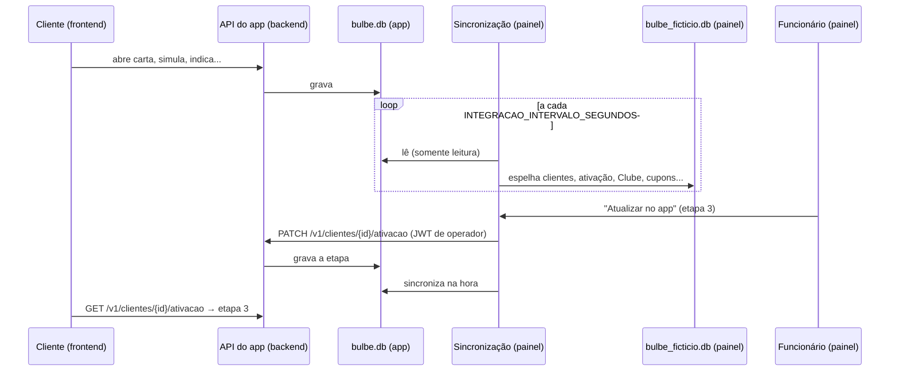

# Integração com o app (v3)

O sistema de gerenciamento e o app da Bulbe (pasta [`../../backend`](../../backend) + [`../../frontend`](../../frontend))
funcionam juntos: o que o cliente faz no app aparece no painel, e a etapa de ativação alterada no painel aparece no app.



## 1. Por que sincronizar (e não trocar o banco do painel)

Os dois bancos nasceram do mesmo contrato, mas têm papéis diferentes:

- o **banco do app** guarda o que o app cria: clientes, jornada de ativação, Clube (ofensiva, cartas, cupons),
  indicações, simulações, adesões, parceiros, dicas e usinas;
- o **banco do painel** guarda o que só o painel tem: funcionários, faturas, notificações, atendimentos, conversas do
  chat e auditoria, além do histórico fictício que alimenta métricas e o chatbot.

A sincronização copia o primeiro grupo para o banco do painel. Assim as 19 ferramentas do chatbot, as métricas e as
telas continuam funcionando sem mudança, e passam a mostrar os dados reais do app.

## 2. Sincronização app → painel

Código: [`app/integracao/sincronizacao.py`](../app/integracao/sincronizacao.py).

- **Somente leitura:** o SQLite do app é aberto com `mode=ro`; a sincronização nunca escreve no banco do app.
- **Quando roda:** ao subir o servidor, a cada `INTEGRACAO_INTERVALO_SEGUNDOS` (30 por padrão, numa thread, sem
  travar a API), depois de cada mudança de etapa feita no painel e pelo botão **Sincronizar com o app** (admin).
- **Transação única:** se algo falhar, o banco do painel fica como estava e o erro aparece no estado da integração.

### 2.1 Vínculo em vez de duplicação

Cada linha espelhada guarda o id do app em `id_app`. Antes de criar uma linha nova, a sincronização procura o mesmo
registro no banco fictício:

| Dado | Equivalente no painel |
|---|---|
| Cliente | mesmo CPF; senão, mesmo e-mail |
| Parceiro | mesmo nome (sem acento e caixa) |
| Usina | mesmo nome |
| Dica | mesmo título |

Encontrou: a linha fictícia é **vinculada** (`importado_do_app = False`) e recebe os dados do app. Não encontrou: a
linha é **criada** (`importado_do_app = True`), mantendo o UUID do app como id quando ele está livre.

Exemplo: a persona *Marcos Andrade* existe nos dois seeds com o mesmo e-mail. No painel ela continua uma só, com o
CPF, o endereço, a etapa e o Clube do app, e mantém o que só o painel tem (código `MARCOS50`, faturas, atendimentos).

Ao vincular um cliente, a ativação e o **Clube fictício dele (cartas, cupons e ofensiva) dão lugar aos do app**, que
são o que o cliente vê na tela. Faturas, notificações, atendimentos e o histórico fictício de indicações e simulações
continuam.

### 2.2 Regras de cada dado

| Dado do app | No painel |
|---|---|
| `clientes` | `clientes` (`acesso_habilitado` → `app_acesso_habilitado`; CPF, telefone e CEP só com dígitos; código de indicação gerado para clientes novos) |
| `ativacoes` | `ativacoes`; mudança de etapa vira evento em `ativacao_eventos` ("Etapa N registrada no app."); as observações do app também viram eventos |
| `ofensivas_clube` + `cartas` | `clube_status` (sequência limitada a 0–5, próxima carta e bônus especial pendente calculados das cartas) |
| `cartas` | `cartas` (situação `bloqueada` do app vira `disponivel` com data futura) |
| `cupons` | `cupons` (parceiro ligado pelo id do app ou pelo nome) |
| `indicacoes` | `indicacoes` (`cancelada` → `expirada`; canal `email` se o contato tem `@`, senão `whatsapp`) |
| `simulacoes` | `simulacoes` (`origem = cliente` quando tem `cliente_id`; usa a `economia_total` calculada pelo app com a bandeira) |
| `adesoes` | `adesoes` (`origem = app`; ligada ao cliente do painel com o mesmo CPF) |
| `parceiros`, `dicas`, `usinas` | mesmas tabelas (a logo local do parceiro vinculado é mantida) |

Registro removido no app: a linha **importada** é apagada no painel (com os filhos); a linha **vinculada** só perde o
vínculo e volta a ser fictícia.

## 3. Painel → app: etapa de ativação

Código: [`app/integracao/api_app.py`](../app/integracao/api_app.py).

Na ficha de um cliente do app (selo **App**), o funcionário escolhe a nova etapa e, se quiser, uma observação, e clica
em **Atualizar no app**. O painel:

1. chama `PATCH /v1/clientes/{id_app}/ativacao` na API do app com um token JWT de operador
   (login com `INTEGRACAO_APP_API_EMAIL`/`INTEGRACAO_APP_API_SENHA`; o token é reaproveitado e renovado se expirar);
2. grava `alterar_ativacao` na auditoria (quem, qual cliente, etapa e observação);
3. sincroniza na hora e devolve a ativação atualizada.

Clientes só do banco fictício não têm o botão (a rota responde `409 CLIENTE_SEM_VINCULO_APP`).

| Erro | Quando |
|---|---|
| `503 APP_INDISPONIVEL` | a API do app não respondeu |
| `502 APP_CREDENCIAIS_INVALIDAS` | o operador configurado não conseguiu entrar na API |
| `404 CLIENTE_NAO_ENCONTRADO_NO_APP` | o cliente foi removido no app |
| `422 ATIVACAO_INVALIDA` | o app recusou a etapa |

## 4. Rotas novas

| Método | Rota | Quem | O quê |
|---|---|---|---|
| GET | `/v1/painel/integracao` | qualquer funcionário | Configuração (sem segredos) e resultado da última sincronização |
| POST | `/v1/painel/admin/sincronizar` | admin | Sincroniza agora; grava `sincronizar_app` na auditoria |
| PATCH | `/v1/painel/clientes/{id}/ativacao` | qualquer funcionário | Altera a etapa no app (corpo `{etapa_atual: 1-5, observacao?}`) |

`GET /v1/painel/clientes/{id}` passa a trazer `cliente.id_app` e `cliente.origem` (`app` ou `ficticio`); as listas
de clientes trazem `origem`.

## 5. Configuração

| Variável | Padrão | Para quê |
|---|---|---|
| `INTEGRACAO_APP_DB_URL` | `../backend/bulbe.db`, se existir | Banco do app (o mesmo `BULBE_DATABASE_URL` do backend). **Vazia = integração desligada** |
| `INTEGRACAO_INTERVALO_SEGUNDOS` | `30` | Intervalo da sincronização automática; `0` = só ao subir e pelo botão |
| `INTEGRACAO_APP_API_URL` | `http://127.0.0.1:8000` | Endereço da API do app |
| `INTEGRACAO_APP_API_EMAIL` / `_SENHA` | operador de demonstração do seed do backend | Operador usado para alterar a etapa |

Em produção, crie um operador próprio para o painel na API do app e informe as credenciais pelo ambiente.

## 6. Banco do painel

As tabelas que espelham o app ganharam duas colunas (`id_app`, `importado_do_app`) e a auditoria ganhou as ações
`sincronizar_app` e `alterar_ativacao`. Num banco local da v2, recrie-o com o servidor parado:

```bash
.venv\Scripts\python.exe -m app.database.seed
```

(Sem recriar, `inicializar_banco()` acrescenta as colunas, mas a restrição de ações da auditoria antiga recusa as duas
ações novas: a integração funciona e só esses registros de auditoria deixam de ser gravados.)

## 7. Testes

- `tests/test_integracao_app.py`: banco do app temporário com o mesmo esquema das migrations e API do app simulada
  por um servidor HTTP local; cobre vínculo, criação, idempotência, mudança de etapa, remoção, somente leitura, a rota
  de alterar etapa e os erros.
- `../../integration-tests/test_sistemas_integrados.py`: sobe a API real do app (migrations e seed num diretório
  temporário), usa a jornada por HTTP, sincroniza o painel e altera a etapa pelo painel, conferindo na API do app.
